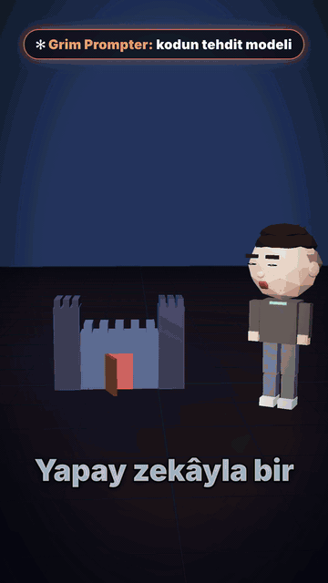
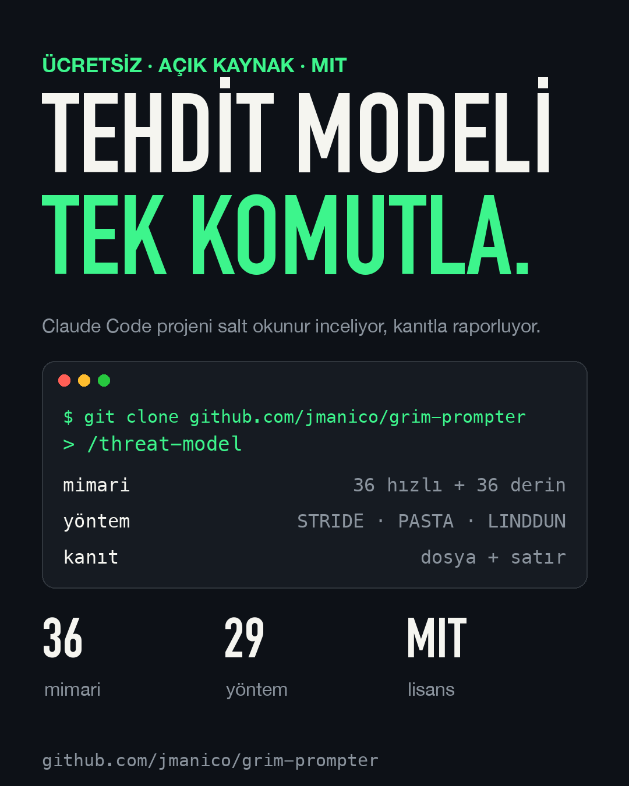

# Kodu yapay zekâ ile hızla yazıyoruz. Peki güvenlik açıklarını kim arıyor?

36 mimari. 29 yöntem. Her bulgu dosya ve satırla.

Grim Prompter.

Güvenli kod eğitmeni Jim Manico'nun (Manicode Security kurucusu) açık kaynak tehdit modelleme kütüphanesi:
→ projeni Claude Code, Codex ya da başka bir ajana tehdit modellettiriyorsun
→ 36 mimari için hızlı ve derin akış: web, API, mobil, mikroservis, RAG, ajan tabanlı yapay zekâ…
→ 29 yöntem: STRIDE, PASTA, LINDDUN, saldırı ağaçları, MITRE ATT&CK, CVSS…
→ her bulgu dosya ve satır numarasıyla gösteriliyor
→ inceleme salt okunur; derleme, test, kurulum ve ağ erişimi senin iznine bağlı
→ MCP araçlarında hangi aracın hangi kimlik bilgisine eriştiğini de çıkarıyor
→ dal değişikliklerini önceki modelle karşılaştırıyor

Kurulum (Claude Code):
git clone https://github.com/jmanico/grim-prompter.git ~/grim-prompter
ln -s ~/grim-prompter/skills/threat-model ~/.claude/skills/threat-model
Sonra projende: /threat-model

Bizim saydığımız: GitHub dosya ağacında 36 hızlı + 36 derin mimari akışı ve 29 yöntem dosyası var, README ile aynı.

**📊 Rakamlarla:**
• 36 mimari
• 29 yöntem
• MIT lisans

**⚙️ Nasıl başlarsın:**
$ git clone github.com/jmanico/grim-prompter
> /threat-model

**📌 Kısa notlar:**
• mimari: 36 hızlı + 36 derin
• yöntem: STRIDE · PASTA · LINDDUN
• kanıt: dosya + satır

**✨ Öne çıkanlar:**
• 36 mimari, 29 yöntem
• her bulgu dosya + satırla
• salt okunur inceleme

Projenizin tehdit modelini en son ne zaman çıkardınız?

[▶ Tam kalite video: video.mp4](video.mp4)

## Videoda adım adım

1. Adı Grim Prompter, güvenli kod eğitmeni Jim Manico'nun ücretsiz tehdit modelleme kütüphanesi.
2. Tek komutla Claude Code projeni inceliyor ve tehditleri dosya ve satır numarasıyla raporluyor.
3. Web, mobil, mikroservis ve yapay zekâ ajanları dahil 36 mimari için hazır akış var.
4. 29 farklı tehdit modelleme yönteminden birini seçip sadece onu uygulatabiliyorsun.
5. İnceleme salt okunur kalıyor, ajan araçlarının hangi anahtarlara eriştiğini de tek tek çıkarıyor.
6. Derleme, test, kurulum ve ağ erişimi ise ancak senin açık iznine bağlı.
7. GitHub'daki dosya ağacını saydık, 36 mimari ve 29 yöntem dosyası gerçekten orada.
8. Kurmak için repoyu klonlayıp skill klasörünü bağlıyorsun, sonra projende tehdit modeli komutunu yazıyorsun.

## Kaynak

- https://github.com/jmanico/grim-prompter.git
- https://github.com/jmanico/grim-prompter

## Lisans

Bu depodaki video, kart ve metinler MIT lisanslıdır (LICENSE). Anlatılan aracın kendi lisansı kendi deposundadır.
